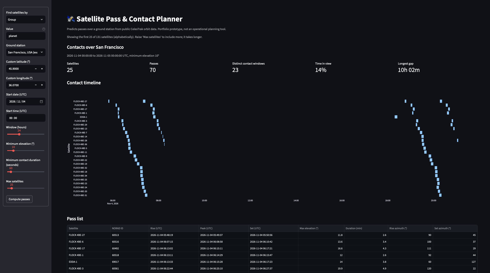
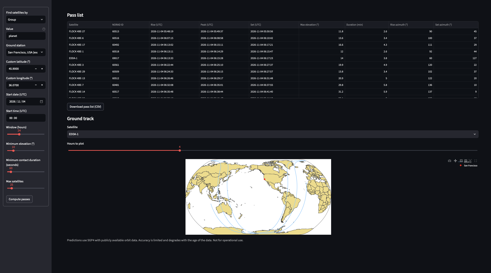

#  Satellite Pass & Contact Planner

A Streamlit app that predicts when satellites pass over a ground station, using public orbit data from [CelesTrak](https://celestrak.org) and the [Skyfield](https://rhodesmill.org/skyfield/) library. It lists passes, merges them into contact windows, reports coverage and gaps, and plots ground tracks.

> Prototype, not a real operational planning tool. Predictions use publicly available orbit data and SGP4, whose accuracy is limited and degrades as the data ages.

## Features

- **Pass prediction** for one or many satellites over a ground station: rise, peak, and set times, maximum elevation, duration, and rise/set azimuth
- **Contact windows**: passes above a minimum elevation and duration, merged across satellites, so overlapping passes count as one stretch of coverage
- **Coverage statistics**: share of the window with a satellite in view, number of distinct contacts, and the longest gap
- **Contact timeline** and downloadable **pass list (CSV)**
- **Ground track map** that handles the ±180° longitude wrap correctly
- **Data-age warnings** when a satellite's orbit data is far from the prediction time
- **Polite data access**: on-disk caching, validation before caching, fallback to the last good copy, and no automatic retries





## Why OMM instead of TLEs

Two-line element sets (TLEs) cannot represent catalog numbers above 99999, and [CelesTrak has announced](https://www.celestrak.org/NORAD/documentation/sup-gp-queries.php) that it expects to run out of 5-digit catalog numbers in mid-2026. Objects cataloged after that point get 6-digit numbers and are **not available as TLEs**. CelesTrak recommends the OMM formats (CSV, JSON, XML) instead, and CSV is now its default.

This project therefore downloads **OMM CSV** and builds satellites with Skyfield's `EarthSatellite.from_omm`. Six-digit catalog IDs work without special handling, since they are stored as text.

## How it works

```
gpdata.py      download, cache, and validate OMM CSV from CelesTrak
     │
propagate.py   Skyfield: satellites, find_events, ground tracks, element age
     │
windows.py     assemble passes, merge windows, compute coverage and gaps
groundtrack.py split a track at the antimeridian for plotting
stations.py    ground station definitions and example sites
     │
app.py         Streamlit dashboard
```

All scheduling logic (`windows.py`, `groundtrack.py`, `gpdata.py`, `stations.py`) is plain Python with no Skyfield dependency, so it is tested directly. `propagate.py` is the only module that imports Skyfield.

### What counts as a contact

A **pass** runs from the moment a satellite rises above the minimum elevation to the moment it sets below it. A **contact window** is a pass that also meets the minimum duration. Overlapping or touching passes from different satellites are merged, so "time in view" never double-counts. Passes already in progress at the start of the window, or still in progress at the end, are left out.

## Getting started

Requires Python 3.10 or newer.

```bash
git clone <https://github.com/shrutix/pass-planner.git>
cd pass-planner
 
python3 -m venv .venv
source .venv/bin/activate        # Windows: .venv\Scripts\Activate.ps1
 
python -m pip install --upgrade pip
python -m pip install -r requirements.txt
 
python -m streamlit run app.py
```

In the sidebar, choose how to find satellites (group, name, or catalog number), a ground station, a start time (UTC), and a window, then click **Compute passes**. Nothing is downloaded until you click.

### Finding Planet's satellites

The default query is the CelesTrak group `planet`. Confirm the exact `GROUP` value on CelesTrak's current satellite data page, and change it in the sidebar if it differs. You can also search **by name** (for example part of a satellite's name) or by catalog number. If a query returns nothing, the app shows the start of CelesTrak's response so you can see why.

### Data access etiquette

CelesTrak asks clients not to repeat requests that fail with HTTP 403 or 404 and may block abusive addresses (see its [usage policy](https://celestrak.org/usage-policy.php)). This app caches each query on disk for 6 hours, never retries a failed request, and keeps using the last good copy if CelesTrak is unreachable. Cached files live in `.cache/`. Set a real contact in `USER_AGENT` in `gpdata.py` before heavy use.

## Tests

```bash
python -m pytest
```

| File | Covers |
| --- | --- |
| `test_gpdata.py` | query URLs, OMM CSV validation, caching, stale fallback, bad responses |
| `test_windows.py` | pass assembly, filtering, window merging, coverage and gaps |
| `test_groundtrack_and_stations.py` | longitude wrapping, antimeridian splitting, station validation |
| `test_propagate.py` | Skyfield layer: pass geometry, latitude bounds, ground-track smoothness (skipped if Skyfield is missing) |

The Skyfield tests check physical invariants (for example, a polar orbit passes a polar station more often than an equatorial one, and ground-track latitude never exceeds the orbit's inclination) instead of exact times, so they need no network access. The orbit data in `tests/sample_data.py` is made up to resemble real orbits and is not real catalog data.

## Accuracy and limitations

- Predictions come from SGP4 using mean elements. Expect errors that grow with the age of the data, typically over a couple of weeks. The app warns when data is more than 14 days from the start time.
- Elevation is computed for a simple point on the WGS84 ellipsoid. Terrain, antenna masks, weather, and spacecraft attitude are ignored.
- Only complete passes inside the window are listed.
- Ground stations in the preset list are example sites, not any operator's real stations.

## License

This project is released under the [MIT License](LICENSE).
